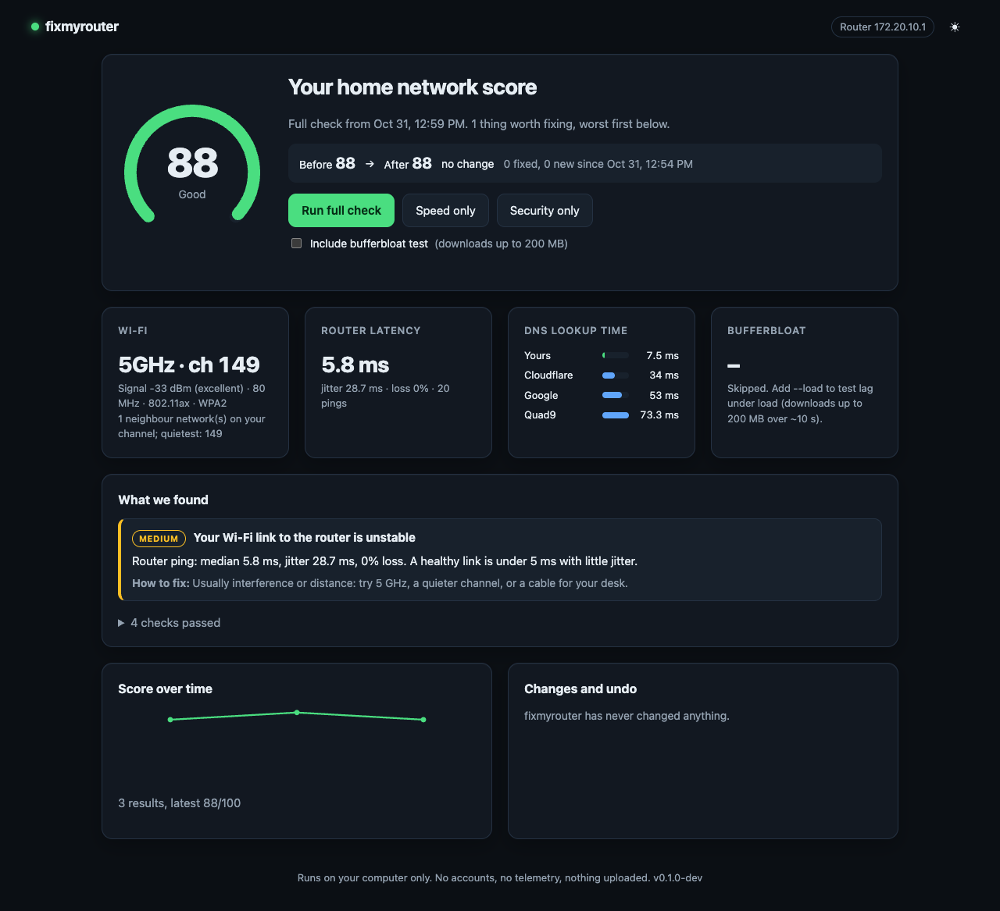

# Your Wi-Fi is slow and maybe unsafe. Find out why in 10 seconds, fix it with one yes.

**fixmyrouter** checks the network your family uses every day (crowded channel, 2.4 GHz, weak signal, slow DNS, lag under load, Telnet left open, UPnP, weak encryption), gives it a score out of 100, and tells you what to change in plain English. It's read-only until you say yes, and every change has a one-command undo.

[](https://github.com/kavinbm/fixmyrouter/actions/workflows/ci.yml)




<sub>The real UI on the author's network (a phone hotspot), dark mode. **TODO:** before/after GIF of a real fix on a home router.</sub>

## Quick start

```sh
git clone https://github.com/kavinbm/fixmyrouter && cd fixmyrouter
make build && ./bin/fixmyrouter ui        # or: ./bin/fixmyrouter check
```

You need Go 1.22+. These one-liners go live with the first tagged release (**coming soon**; the config and script are in this repo and tested locally):

```sh
brew install kavinbm/tap/fixmyrouter                                                  # macOS, Linux
curl -fsSL https://raw.githubusercontent.com/kavinbm/fixmyrouter/main/install.sh | sh  # macOS, Linux (verifies SHA-256)
go install github.com/kavinbm/fixmyrouter/cmd/fixmyrouter@latest                       # anywhere with Go
```

Windows: download the zip from Releases (coming soon).

## What you get

```text
$ fixmyrouter check
Wi-Fi:      5GHz, channel 149 (80 MHz), 802.11ax, link rate 1200 Mbps, WPA2
Signal:     -37 dBm (excellent), noise -93 dBm, SNR 56 dB
Router:     ping 172.20.10.1 median 11.6 ms, jitter 39.9 ms, loss 0% (20 pings)
DNS lookup time (median of popular sites):
  Your current DNS   fe80::1435:b7ff:fe67:5764%en0    7.3 ms
  Cloudflare         1.1.1.1                        36.2 ms
  ...
⚠️  WARN  Your Wi-Fi link to the router is unstable [medium]
   Router ping: median 11.6 ms, jitter 39.9 ms, 0% loss. A healthy link is under 5 ms with little jitter.
   How to fix: Usually interference or distance: try 5 GHz, a quieter channel, or a cable for your desk.
✅ PASS  Telnet (port 23) [info]
...
Score: 88/100 (Good). 4 pass, 1 warn, 0 fail, 0 could not run.
```

| Command | What it does |
|---|---|
| `fixmyrouter check` | Everything below, one 0-100 score, worst problems first. `--load` adds the bufferbloat test. |
| `fixmyrouter speed` | Wi-Fi band, channel, width, signal/noise, link rate; channel congestion and the quietest channel; router latency, jitter and loss; your DNS vs Cloudflare, Google and Quad9. |
| `fixmyrouter audit` | Router security: admin page over plain HTTP, Telnet open, UPnP port forwarding (IGD), Wi-Fi encryption (open/WEP/WPA/WPA2/WPA3). Talks only to your router. |
| `fixmyrouter ui` | The dashboard above, on `127.0.0.1` only: score gauge, before/after, findings, "apply this fix" with a confirmation, undo history. |
| `fixmyrouter fix [id]` | Lists, or applies after a yes, the fixes it can make for you. Today: switch this Mac's DNS to the fastest resolver. |
| `fixmyrouter undo` | Puts back the last change from its snapshot (`--all` for every change). |
| `fixmyrouter history` | Past scores and every change ever made. |
| `fixmyrouter mcp` | MCP server for Claude Code, Codex and Gemini CLI. |
| `fixmyrouter profiles validate` | Checks community router profiles (for contributors). |

Every command takes `--json`. Exit codes are stable: `0` nothing to fix, `1` error, `2` usage, `3` found something to fix.

### Platform support

| | macOS | Linux | Windows |
|---|---|---|---|
| Gateway, security checks, DNS, ping | ✅ tested | ✅ parsers unit-tested | ✅ parsers unit-tested |
| Wi-Fi details and neighbour scan | ✅ `system_profiler` | `iw` + `nmcli` | `netsh wlan` |
| Automatic DNS fix + undo | ✅ tested on a real Mac | manual steps (coming soon) | manual steps (coming soon) |

Only macOS has been run end to end so far. Linux and Windows build in CI and their OS-output parsers have unit tests, but nobody has run them on real hardware yet. If you do, please [share a result](https://github.com/kavinbm/fixmyrouter/issues/new?template=result.yml).

## Safety promises

- **Read-only until you say yes.** Every check only reads. The one thing fixmyrouter can change (this computer's DNS on macOS) needs an explicit yes, saves a snapshot first, checks the change took, and `fixmyrouter undo` puts it back.
- **Never touches your router's settings.** It never logs in to the router, never sends a password (default or otherwise), never brute forces anything and never touches firmware. Router fixes are step-by-step instructions, with exact menu paths when a community profile matches your model.
- **Your router only.** Router probes go only to your own default gateway, which comes from your OS routing table. You can't point it at another IP, and it refuses to run if the gateway isn't a private LAN address. The one exception is the UPnP check's standard SSDP discovery packet: like every phone and TV, it goes to the LAN multicast group, and only the gateway's replies are read.
- **No telemetry, no accounts, no cloud.** Outside traffic is only what you'd expect from a speed check: DNS test lookups to 1.1.1.1, 8.8.8.8 and 9.9.9.9, the Cloudflare download if you ask for `--load` (up to 200 MB), and a MAC-prefix lookup if you pass `discover --online`. Results stay in `~/.fixmyrouter`.
- **The UI is local.** It listens on 127.0.0.1, loads nothing from the internet, and every API call needs a per-run secret token, so other websites can't drive it.

## Paste this into your coding agent

Using Claude Code, Codex, Gemini CLI or Cursor? Paste this:

```text
Use fixmyrouter (https://github.com/kavinbm/fixmyrouter) to find out why my Wi-Fi is slow or unsafe.
Follow PROMPT.md in that repo exactly: run `fixmyrouter check --json`, explain the score and each
finding to me in plain language, walk me through router settings step by step, and ask me before
every change. Never log in to my router.
```

Agents that speak MCP can call it directly: `claude mcp add fixmyrouter -- fixmyrouter mcp`. See [PROMPT.md](PROMPT.md).

## How the score works

Start at 100. Each open problem costs points by severity: high 25, medium 12, low 5. Passing checks and checks that couldn't run cost nothing. 90+ is Great, 75+ Good, 50+ Needs work, below that At risk. The thresholds behind each finding (signal below -67 dBm, router jitter above 10 ms, 15+ ms DNS gap, +60 ms under load...) live in [`internal/speed/speed.go`](internal/speed/speed.go). They're a first calibration, and real before/after results will tune them.

## Roadmap

- [x] Speed: Wi-Fi band/channel/signal, congestion, router latency and jitter, DNS comparison, bufferbloat
- [x] Security: plain-HTTP admin, Telnet, UPnP IGD, Wi-Fi encryption
- [x] 0-100 score, `check`, JSON, stable exit codes, local UI, MCP server
- [x] Opt-in fix with snapshot and undo (DNS on macOS)
- [x] Router profiles with validation and editor schema
- [ ] First tagged release: Homebrew tap, curl installer, Windows zip (**coming soon**)
- [ ] Run and fix on real Linux and Windows machines; DNS fix there
- [ ] Upload bufferbloat, multi-stream throughput
- [ ] More security checks: WPS, WAN-side remote admin, firmware age (from profiles)
- [ ] 20+ verified router profiles, starting with Indian ISPs (JioFiber, Airtel Xstream) and TP-Link, D-Link, Netgear
- [ ] Before/after share card in the UI

## Contributing

The most useful contribution needs no Go: **add your router**. Copy one YAML file, fill in where each setting lives, and run `fixmyrouter profiles validate profiles`. See [profiles/README.md](profiles/README.md), or use the [Add my router](https://github.com/kavinbm/fixmyrouter/issues/new?template=router-profile.yml) form. Code contributions: [CONTRIBUTING.md](CONTRIBUTING.md). Starter tasks: [GOOD_FIRST_ISSUES.md](GOOD_FIRST_ISSUES.md).

### Contributors

<a href="https://github.com/kavinbm/fixmyrouter/graphs/contributors"></a>

## License

MIT, see [LICENSE](LICENSE). Security issues: see [SECURITY.md](SECURITY.md).
